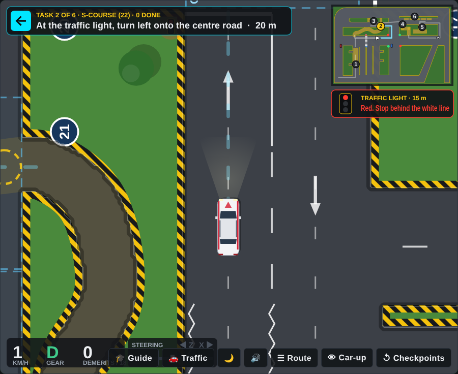
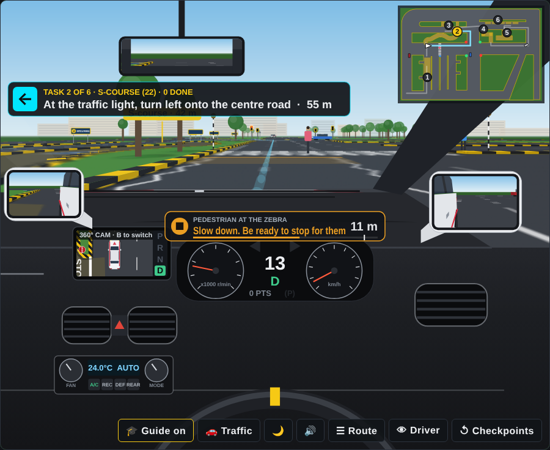

# TP Circuit Trainer

**Practise the Singapore Traffic Police (TP) driving test circuit in your browser — free, no install.**

▶ **[Try it live](https://thinking-cookie.github.io/TP-simulator/)**

  
**Like it? Follow, like and share on TikTok to help more learners find it.**

---

## The problem

Learner drivers in Singapore get limited circuit time. Lessons are paid by the hour, and the circuit is only open during booked slots. Between lessons there is no way to rehearse the course order, the signalling, or the blind-spot checks that cost the most demerit points.

Most learners end up memorising the circuit from YouTube videos — watching, not doing.

## The solution

A browser-based trainer that lets learners **drive** the circuit, not just watch it. It scores them the way an examiner would, so they know which habits to fix before their next lesson.

| What learners practise | How the trainer helps |
|---|---|
| Course order and route | Yellow guide arrow, route brief, minimap |
| Crank course, S-course, slope, directional change, parallel and vertical parking | Each course is a checkpoint that can be replayed on its own |
| Signalling and blind-spot checks | Blue zones before every turn; points added if either is missed |
| Staying within the demerit limit | Live demerit sheet, fail at more than 18 points |
| Automatic or manual | Manual mode has a clutch, biting point and stalling |

## Features

- **3 camera views** — car-up, north-up, and driver's seat with mirrors and a 360° dash camera
- **Day and night mode**
- **Realistic car sounds** — engine, indicator, horn
- **2 maps** — a practice circuit and a circuit modelled on the CDC Ubi layout
- **Checkpoint retry** — jump back to any course and practise it on repeat
- **Road rules on the CDC map** — a signalised junction, a zebra crossing with pedestrians, and STOP lines at the S-course and crank exits
- **Other road users** — three cars on keep-left loops (they signal, queue and stop at red lights) and pedestrians at the zebra. Press `T` to turn them off
- **Test areas marked** — each course is tinted with a numbered name plate, signposts at each entrance, and your target bay and lot highlighted
- **Mistake map** — at the end or on a fail, a map shows a numbered marker where each fault happened
- **Beginner guide** (off by default, press `G`) — tells you when to get ready to turn, signal and check, when to brake for a line, and when you are too close, plus parking-sensor beeps when reversing
- **Over-the-shoulder checks** — tap `Q`/`E` for a quick glance, hold to look out of the rear side window
- **3D kerbs** in the driver's seat and mirrors, traced from the same map used for kerb hits
- **Works on desktop and mobile**, single HTML file, no sign-up

| Driver's seat | Night mode |
|---|---|
|  |  |

| Traffic light on the CDC map | Beginner guide at the zebra |
|---|---|
|  |  |

## Demerit rules used

| Fault | Points |
|---|---|
| Striking a kerb | +4 |
| Turning without checking blind spot | +4 |
| Turning without signalling | +4 |
| Rolling back more than 0.5 m on the slope | +6 |
| Mounting a kerb (above 10 km/h) | Immediate fail |
| More than 18 points | Fail |

On the CDC map, road rules add:

| Fault | Points |
|---|---|
| Going on amber when you could stop | +8 |
| Pulling out in front of a car so it brakes hard | +8 |
| Stopping on the zebra crossing | +10 |
| Going on a red light | Immediate fail |
| Not stopping at a STOP line | Immediate fail |
| Not giving way to a pedestrian on the zebra | Immediate fail |
| Hitting another car or a person | Immediate fail |

Road-rule values follow [BTT's published guide](https://www.btt.sg/en/blog/immediate-failures-singapore-practical-driving-test) to the TP marking sheet. The STOP lines and traffic light placement are practice features, not taken from the CDC circuit diagram.

This is a simplified practice tool. Real TP test marking covers more items.

## Product decisions

- **Single HTML file.** No backend, no accounts. Zero friction for a learner who just wants to practise tonight.
- **Scoring over realism.** The physics are simple on purpose. The value is in building the right habits — signal, check, turn — not in a driving simulator.
- **Checkpoint retry.** Learners can replay one weak course without restarting the whole circuit.
- **Automatic and manual.** Covers both Class 3A (auto) and Class 3 (manual) learners.
- **Beginner help is opt-in.** The guide and parking beeps are off by default, so learners practise the way the test runs and switch help on only when they need it.
- **Show where, not just what.** The mistake map ties each fault to a spot on the circuit, so learners know which corner to practise next.

## What's next

- [ ] More circuit layouts (other driving centres)
- [ ] Progress tracking across sessions
- [ ] Theory test (FTT/BTT) quiz mode

## Run it locally

Download `index.html` and open it in any modern browser. That's it.

## Credits

- Built by Alvinelyn — Product Manager, Singapore
- Sounds: [Kenney](https://kenney.nl) (CC0)
- Fonts: Barlow Condensed and Atkinson Hyperlegible via Google Fonts

Not affiliated with the Singapore Traffic Police or any driving centre.

## License

[MIT](LICENSE)
